# Padaone — guide du formateur

Padaone transforme les téléphones de vos participants en outils de participation : sondages, nuage de
mots, pari de certitude, questions du public… Les résultats s'affichent au vidéoprojecteur, quand vous
le décidez.

- **Rien à installer pour les participants** : ils scannent un QR code, une page web s'ouvre.
- **Pas de compte, anonyme** : personne, pas même vous, ne sait qui a répondu quoi.
- **Tout reste dans la salle** : votre PC fait serveur. Aucune donnée ne part sur internet, et Padaone
  marche même sans internet, grâce au point d'accès Wi-Fi qu'il peut créer lui-même.

> Les captures de ce guide viennent d'une séance d'exemple, « Animer des réunions participatives ».

## Sommaire

1. [Les trois fenêtres de Padaone](#1-les-trois-fenêtres-de-padaone)
2. [Lancer Padaone](#2-lancer-padaone)
3. [Accueillir les participants](#3-accueillir-les-participants)
4. [Piloter la séance depuis la console](#4-piloter-la-séance-depuis-la-console)
5. [Les activités](#5-les-activités)
6. [Le signal discret](#6-le-signal-discret)
7. [Le Wi-Fi : réseau de la salle ou point d'accès Padaone](#7-le-wi-fi--réseau-de-la-salle-ou-point-daccès-padaone)
8. [Anonymat, données et reprise après un incident](#8-anonymat-données-et-reprise-après-un-incident)
9. [En cas de souci](#9-en-cas-de-souci)
10. [Mémo des options](#10-mémo-des-options)

---

## 1. Les trois fenêtres de Padaone

| Fenêtre | Pour qui | Où |
| --- | --- | --- |
| **La console** | Vous seul·e, sur votre PC | Votre navigateur, à ne **jamais** projeter |
| **L'écran** | Toute la salle | Le vidéoprojecteur (navigateur en plein écran, touche F11) |
| **La page participant** | Chaque participant | Son téléphone, ouverte par QR code |

Les liens de la console et de l'écran contiennent une **clé secrète** : quelqu'un qui les connaîtrait
pourrait piloter votre séance. Ne les projetez pas, ne les envoyez pas. La clé reste la même d'une
séance à l'autre ; si un lien a fuité, relancez Padaone avec l'option `--nouvelle-cle`.

## 2. Lancer Padaone

Téléchargez la version de votre système sur la page des
[versions de Padaone](https://github.com/julienrat/padaone_V2/releases) : Linux, Windows ou macOS.

### Sous Linux : l'AppImage

Padaone tient en un seul fichier : `Padaone-0.3.0-x86_64.AppImage`, qui tourne sur tout Linux 64 bits.

1. La première fois, rendez le fichier exécutable : clic droit › *Propriétés* › *Permissions* ›
   cochez *Autoriser l'exécution*. Ou, dans un terminal : `chmod +x Padaone-0.3.0-x86_64.AppImage`.
2. **Double-cliquez** dessus : un terminal s'ouvre avec le code et les liens de la séance, et la
   console s'ouvre toute seule dans votre navigateur.
3. Pour terminer la séance : dans ce terminal, **Ctrl+C**.

Pour donner un titre à la séance, lancez-la depuis un terminal :

```bash
./Padaone-0.3.0-x86_64.AppImage --titre "Animer des réunions participatives · jour 1" --ouvrir-console
```

Le terminal affiche alors :

```text
  Padaone 0.3.0 — « Animer des réunions participatives · jour 1 »
  Code de la séance : 342 751

  Participants : http://192.168.1.23:8080/p?code=342751
  Écran        : http://192.168.1.23:8080/ecran?cle=…
  Console      : http://localhost:8080/console?cle=…
```

### Sous Windows

1. Décompressez `Padaone-0.3.0-windows-x86_64.zip` (clic droit › *Extraire tout*), puis double-cliquez
   sur `Padaone.exe`.
2. La première fois, Windows affiche « Windows a protégé votre ordinateur » : cliquez sur
   *Informations complémentaires* puis *Exécuter quand même* (Padaone n'est pas encore signé).
3. Le pare-feu demande l'autorisation : cochez **Réseaux privés**. Sans cela, les téléphones ne
   joindront pas le PC. Le Wi-Fi de la salle doit être déclaré « privé » dans Windows.
4. Une fenêtre noire affiche le code et les liens ; la console s'ouvre dans le navigateur.
   Ctrl+C dans cette fenêtre (ou la fermer) termine la séance.

### Sous macOS

1. Décompressez `Padaone-0.3.0-macos-universel.zip` (Mac Apple ou Intel).
2. La première fois, macOS bloque les programmes non signés par Apple : clic droit (ou Ctrl+clic) sur
   `Padaone` › *Ouvrir* › *Ouvrir*. Au besoin : *Réglages Système* › *Confidentialité et sécurité* ›
   *Ouvrir quand même*.
3. Acceptez les connexions entrantes si macOS le demande.
4. Le Terminal affiche le code et les liens ; la console s'ouvre dans le navigateur. Ctrl+C termine.

> **Sous Windows et macOS**, tout fonctionne sauf le point d'accès Wi-Fi piloté par Padaone et le
> portail captif (§ 7), propres à Linux pour l'instant. Utilisez le Wi-Fi de la salle, un routeur de
> voyage, ou le partage de connexion du système (« Point d'accès sans fil mobile » sous Windows).

### Ensuite, sur tous les systèmes

Ouvrez le lien **Écran** dans une seconde fenêtre du navigateur, déplacez-la sur le vidéoprojecteur
et passez-la en plein écran (F11). Le lien **Console** reste sur votre écran à vous.

## 3. Accueillir les participants

### Ce que la salle voit

Tant qu'aucune activité n'est lancée, l'écran affiche l'accueil : le QR code de la séance, l'adresse
à taper et le code à 6 chiffres. Si le point d'accès Padaone est allumé (voir § 7), une première carte
donne aussi le nom du Wi-Fi, son mot de passe et un QR code qui connecte le téléphone en un geste.

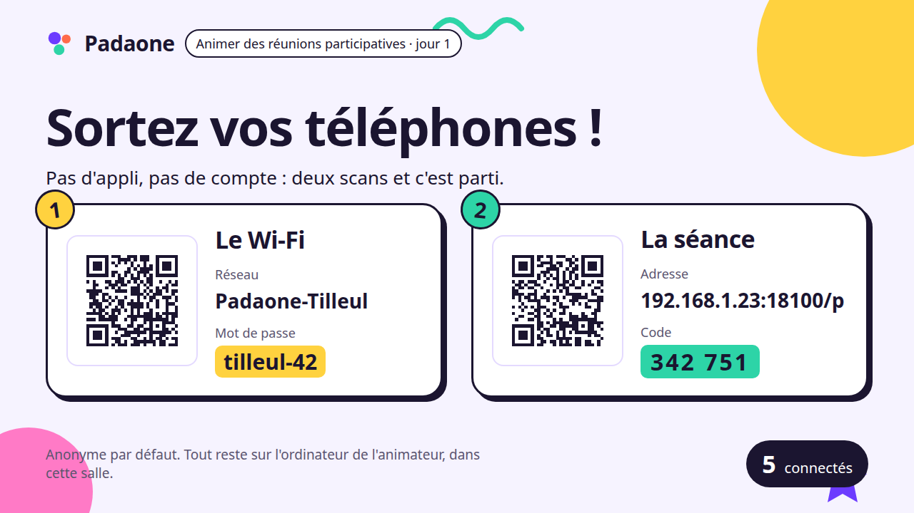

En bas à droite, le compteur indique combien de téléphones sont connectés.

### Ce que voit le participant

<p>
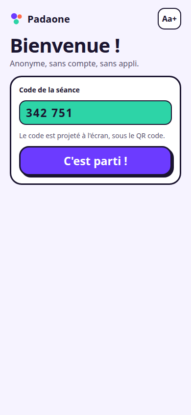
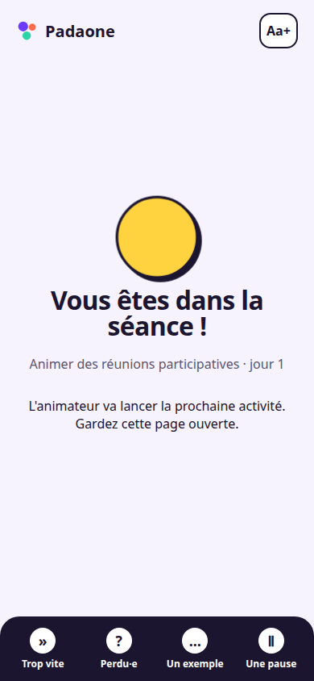
</p>

1. Il scanne le QR code (ou tape l'adresse) : la page **Bienvenue** s'ouvre, code déjà rempli.
2. Il touche **C'est parti !** : il est dans la séance et attend votre première activité.

Pas de nom, pas de compte. Le bouton **Aa+** en haut à droite agrandit le texte. Si le téléphone
perd le réseau, la page se reconnecte seule et le participant retrouve sa place et ses réponses.

## 4. Piloter la séance depuis la console

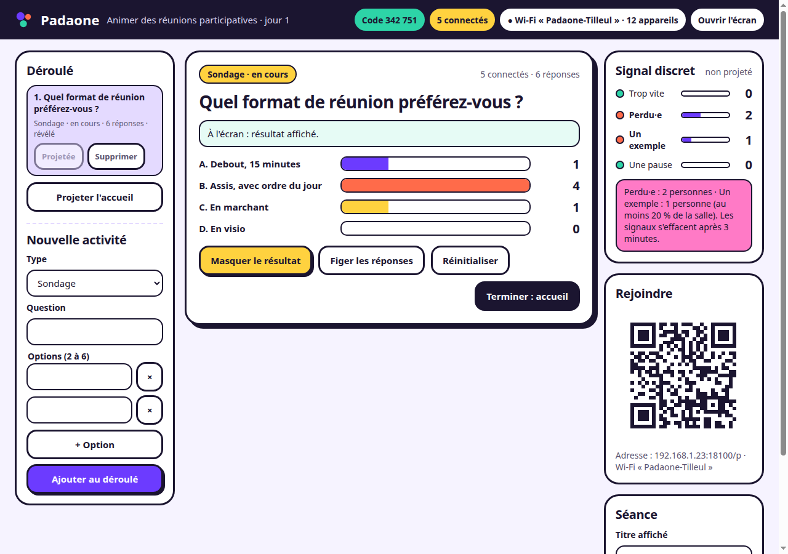

La console a trois colonnes :

- **À gauche, le déroulé** : la liste de vos activités, dans l'ordre. Chacune a un bouton
  **Lancer** (elle passe à l'écran et sur les téléphones) et **Supprimer**. Le bouton
  **Projeter l'accueil** remet l'écran d'accueil (pratique pour accueillir des retardataires).
- **Au centre, l'activité en cours** : les résultats en direct, que **vous seul·e voyez**, et les
  boutons de pilotage.
- **À droite** : le signal discret (§ 6), le QR code de la séance, et le titre affiché (modifiable).

En haut, le lien **Wi-Fi : point d'accès** mène à la page du point d'accès (§ 7) et **Ouvrir l'écran**
ouvre la fenêtre à projeter.

### Préparer une activité

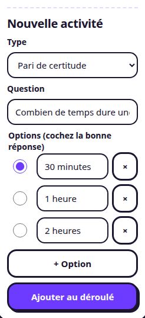

Sous le déroulé, choisissez le **type**, écrivez la question, remplissez les champs propres à
l'activité (options, bonne réponse, échelle…), puis **Ajouter au déroulé**. Vous pouvez tout
préparer avant l'arrivée du groupe : le déroulé est conservé si vous devez relancer Padaone (§ 8).

### Les boutons de l'activité en cours

| Bouton | Effet |
| --- | --- |
| **Révéler le résultat** / **Masquer** | Montre ou cache le résultat à l'écran. Avant, l'écran n'affiche que le nombre de réponses. |
| **Figer les réponses** / **Rouvrir** | Plus personne ne peut répondre ni changer d'avis. |
| **Réinitialiser** | Efface toutes les réponses de l'activité (avec confirmation). |
| **Activité suivante** | Lance l'activité suivante du déroulé. Après la dernière : **Terminer : accueil**. |

Une ligne colorée vous rappelle en permanence **ce que voit la salle** : « résultat masqué »,
« résultat affiché », ou « masqué tant qu'il y a moins de 3 réponses ».

> **Règle d'anonymat.** Rien ne s'affiche à l'écran tant qu'il y a moins de **3 réponses**, même si
> vous avez cliqué sur Révéler. Dans un petit groupe, cela évite de deviner qui a répondu quoi.

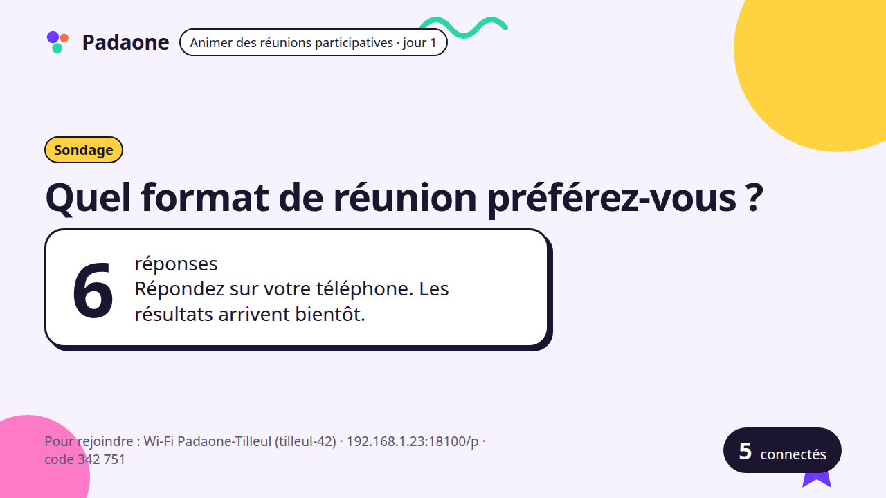

Les participants peuvent **changer d'avis** tant que l'activité n'est pas figée : seule leur dernière
réponse compte.

## 5. Les activités

Chaque activité a sa propre page sur le téléphone et son propre affichage à l'écran. Partout, le sens
n'est jamais porté par la couleur seule (lettres A, B, C…, textes, coches) et les boutons sont assez
grands pour des doigts pressés.

### Sondage

*Pour* : recueillir un avis, vérifier une connaissance, choisir entre plusieurs options.
*Réglages* : une question et de 2 à 6 options.

<p>
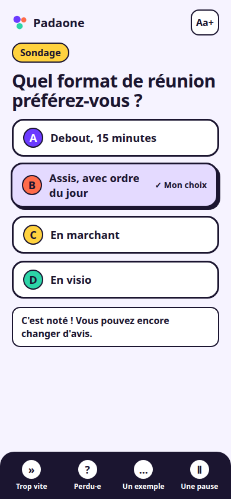
</p>

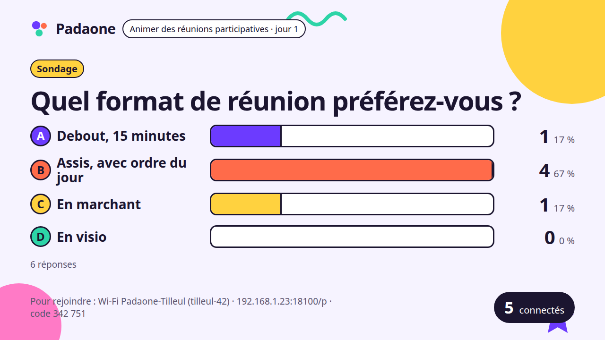

Le participant touche une option (il peut en changer). À l'écran, une fois révélé : barres, effectifs
et pourcentages.

### Cartons de couleur

*Pour* : un vote « à main levée » visible de tous, sans que personne ne lève la main seul·e.
*Réglages* : une question et de 2 à 6 cartons (par défaut *D'accord*, *Pas d'accord*, *Je ne sais pas*).

<p>
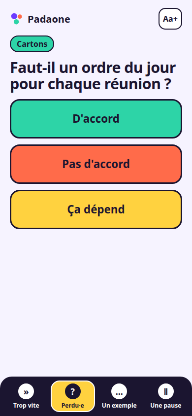
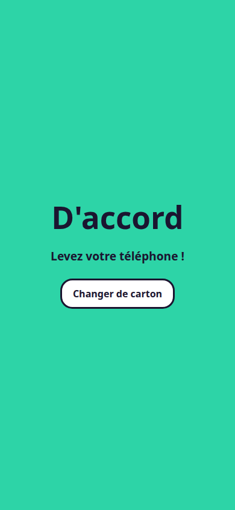
</p>

Le participant choisit son carton : son téléphone devient un grand carton de couleur, avec le texte
écrit dessus. Invitez la salle à lever les téléphones : l'effet est immédiat. L'écran compte les cartons.

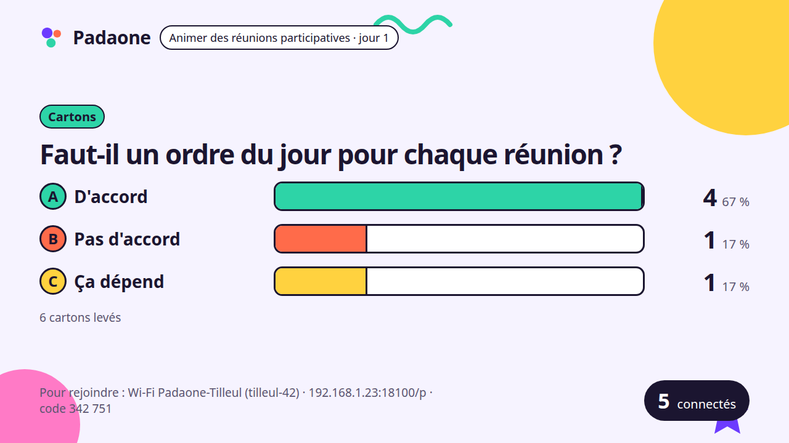

### Nuage de mots

*Pour* : faire émerger les représentations du groupe (« En un mot, c'est quoi… ? »).
*Réglages* : la question, et 1, 2 ou 3 mots par personne (25 caractères au plus par mot).

<p>
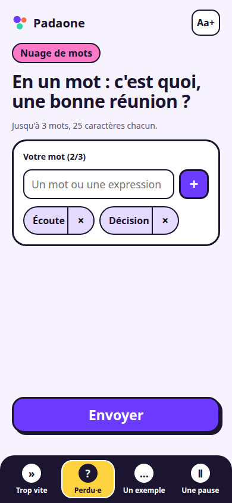
</p>

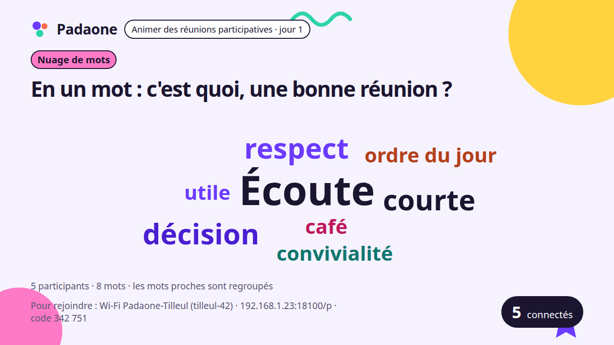

- **Regroupement automatique** : « Écoute », « écoutes » et « l'écoute » comptent pour un seul mot
  (majuscules, accents, pluriels simples et articles ignorés).
- **Placement stable** : un mot posé ne bouge plus, il grossit à mesure que d'autres le proposent.
- **Modération** dans la console : touchez un mot puis un autre pour **fusionner** le second dans le
  premier (« écouter » dans « Écoute ») ; l'œil **masque** un mot de l'écran (« nul » ci-dessous,
  barré). Une fusion se défait en touchant « + écouter ✕ ».

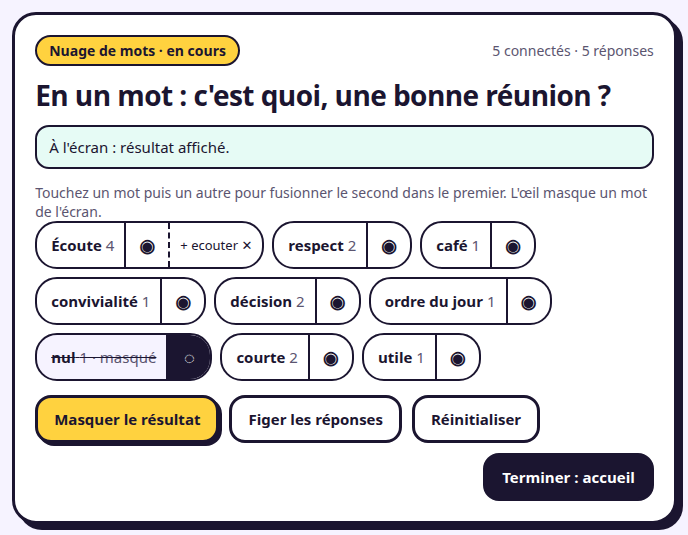

### Échelle

*Pour* : une auto-évaluation, un degré d'accord, un niveau de confiance.
*Réglages* : la question, une échelle de 1 à 5 ou de 1 à 10, et si vous voulez les libellés des
extrémités (« Pas du tout », « Tout à fait »).

<p>
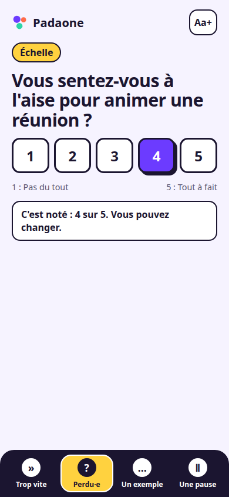
</p>

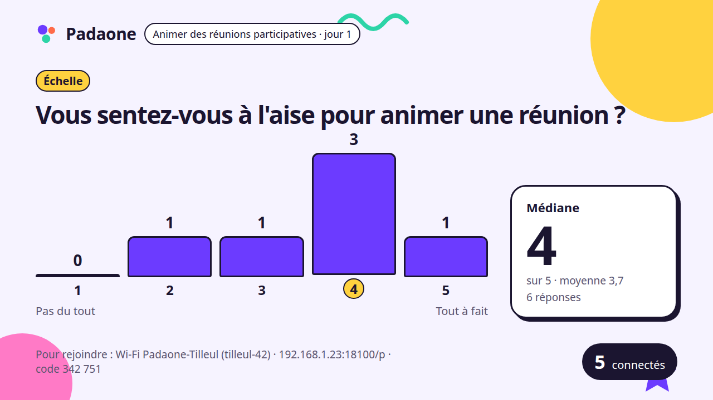

L'écran montre l'histogramme et la **médiane** (la valeur du milieu, entourée), plus parlante que la
moyenne quand les avis sont partagés. La moyenne est indiquée en petit.

### Météo à deux axes

*Pour* : une météo d'ouverture ou de fin de journée plus riche qu'un simple « ça va ».
*Réglages* : la question.

<p>
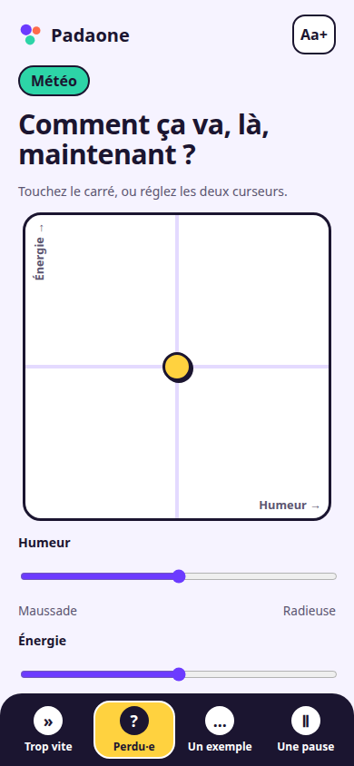
</p>

Le participant pose un point dans un carré : l'**humeur** de gauche à droite, l'**énergie** de bas en
haut. Il peut toucher le carré ou régler les deux curseurs. L'écran montre le nuage de points de la
salle et le point moyen (losange jaune). Les quatre coins aident à lire : *Tendu·e*, *Plein d'élan*,
*À plat*, *Serein·e*.

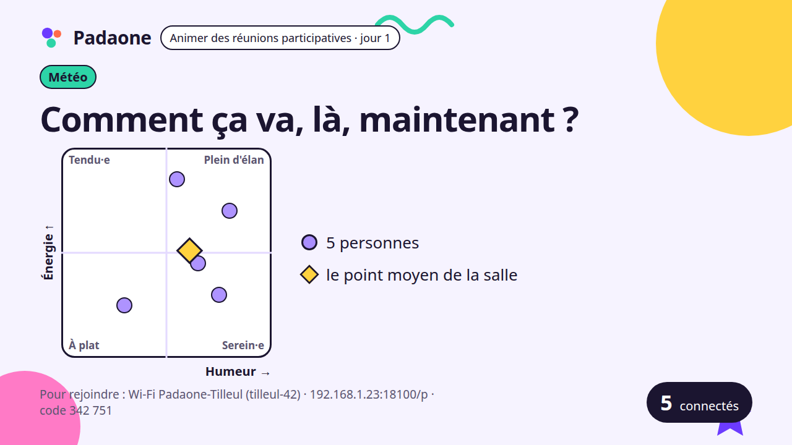

### Pari de certitude

*Pour* : vérifier les acquis **et** repérer les fausses certitudes, les plus dangereuses en formation.
*Réglages* : la question, de 2 à 6 options, et la **bonne réponse** (cochez-la dans le formulaire).

<p>
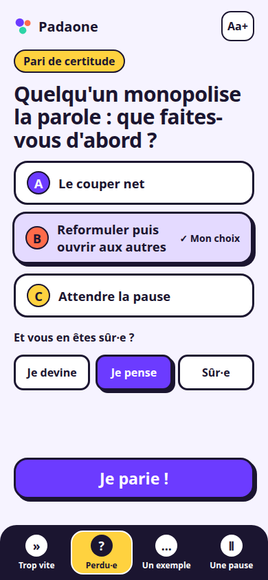
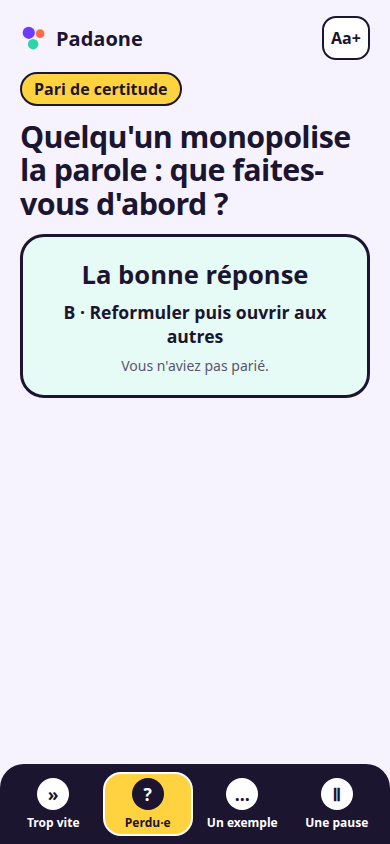
</p>

Le participant choisit sa réponse **et** son degré de certitude : *Je devine*, *Je pense* ou *Sûr·e*.
La bonne réponse n'est envoyée aux téléphones et à l'écran **qu'au moment où vous révélez**.

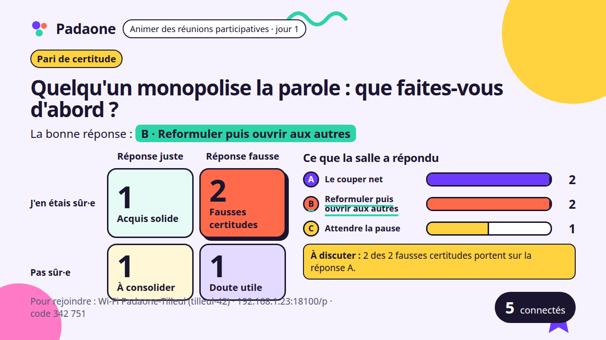

L'écran croise juste/faux et sûr/pas sûr :

| | Réponse juste | Réponse fausse |
| --- | --- | --- |
| **Sûr·e** | Acquis solide | **Fausses certitudes** (en rouge : à reprendre en priorité) |
| **Pas sûr·e** (je devine, je pense) | À consolider | Doute utile |

Un encadré « À discuter » signale l'option qui concentre le plus de fausses certitudes.

### Question ouverte modérée

*Pour* : recueillir des idées, des suggestions, des retours en phrases.
*Réglages* : la question.

<p>
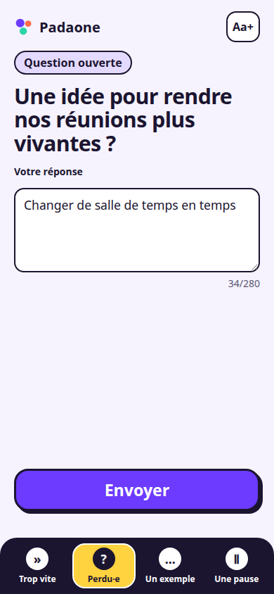
</p>

Chaque participant écrit un texte court (280 caractères). **Rien n'est projeté sans vous** : dans la
console, chaque message a un bouton **Projeter**. Seuls les messages validés s'affichent (les six
derniers). Les auteurs restent anonymes, même pour vous. Si quelqu'un modifie son message, il
doit être validé à nouveau.

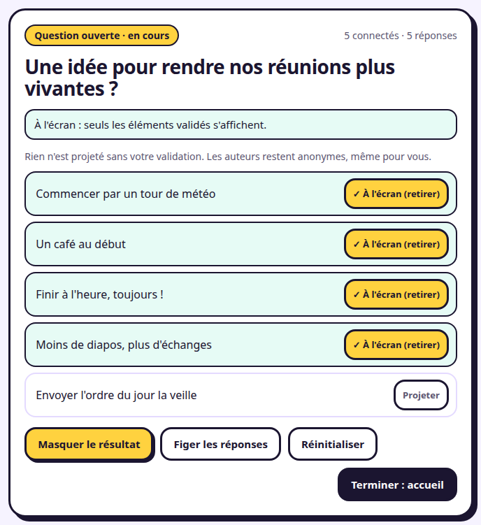

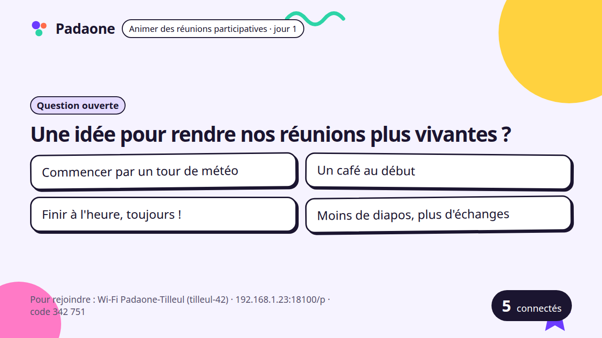

### Questions du public

*Pour* : une session de questions-réponses où les questions qui intéressent le plus remontent.
*Réglages* : une consigne (« Vos questions sur la facilitation »).

<p>
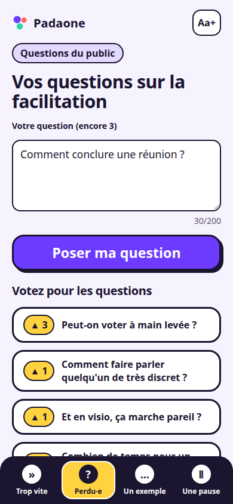
</p>

Chacun peut poser jusqu'à **3 questions** et voter pour celles des autres (un vote par question, qu'on
peut retirer). Une question n'est visible des autres et de l'écran **qu'après votre validation**
dans la console. L'écran les classe par nombre de votes (les six premières).

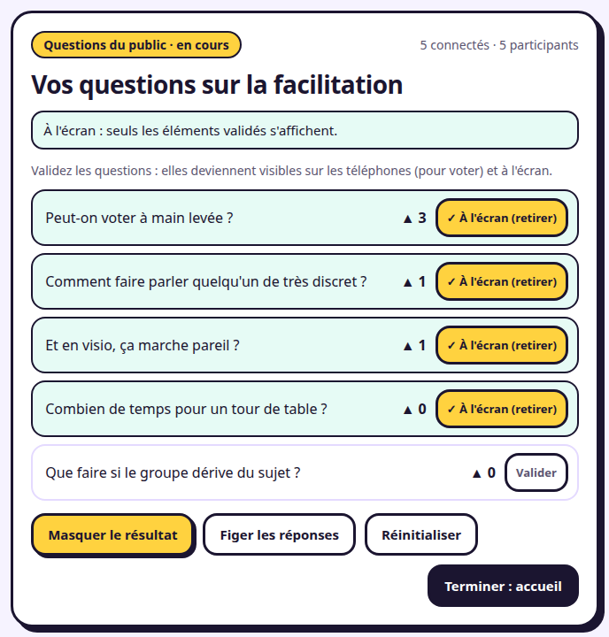

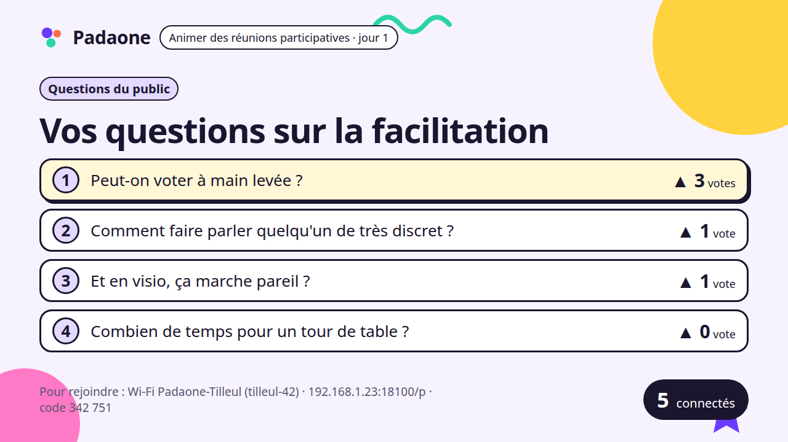

### Remise en ordre

*Pour* : remettre des étapes dans l'ordre (un processus, une procédure, une chronologie), ordonner
des cartes, reconstituer une séquence logique.
*Réglages* : la consigne, puis de **3 à 8 éléments, saisis dans le bon ordre**. Pour chacun : un texte
(40 caractères au plus) et une **couleur** parmi dix ; tous les éléments ont la même forme, un
rectangle arrondi. Un aperçu montre le rendu. Cochez **Minuterie** pour limiter le
temps, de 10 secondes à 60 minutes.

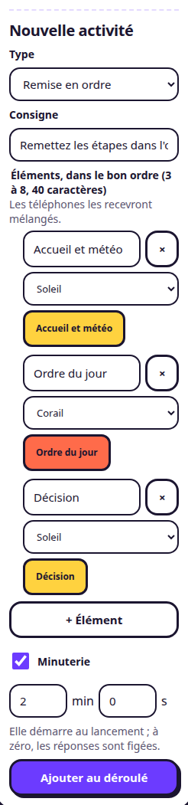

<p>
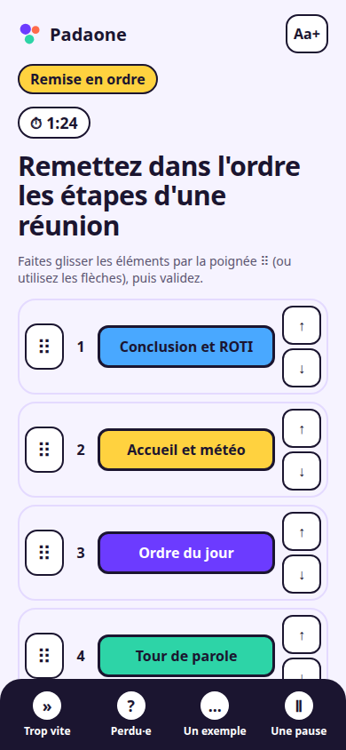
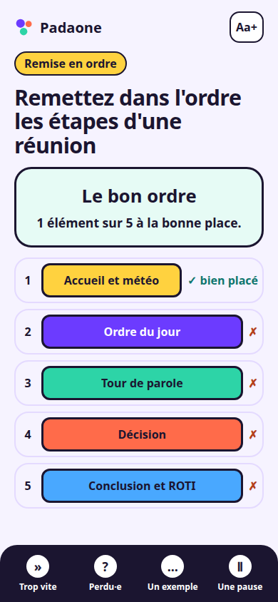
</p>

- Les téléphones reçoivent les éléments **mélangés**. Le participant les fait glisser avec la poignée
  ⠿ (au doigt ou à la souris) ; les flèches ↑ ↓ font la même chose, ainsi que les touches fléchées du
  clavier. Il **valide** quand sa proposition lui semble bonne ; il peut la modifier tant que le temps
  n'est pas écoulé.
- **Minuterie** : elle démarre au lancement de l'activité et s'affiche sur les téléphones, à l'écran
  et dans la console. À zéro, les réponses sont figées automatiquement. Dans la console, **Relancer la
  minuterie** redonne la durée complète (et rouvre les réponses), **Arrêter la minuterie** la suspend.
- Rien ne trahit le bon ordre avant que vous ne **révéliez** : l'écran montre alors le bon ordre, le
  nombre de propositions parfaites et, pour chaque élément, la part de la salle qui l'a bien placé.
  Chaque participant voit sur son téléphone combien d'éléments il avait bien placés.

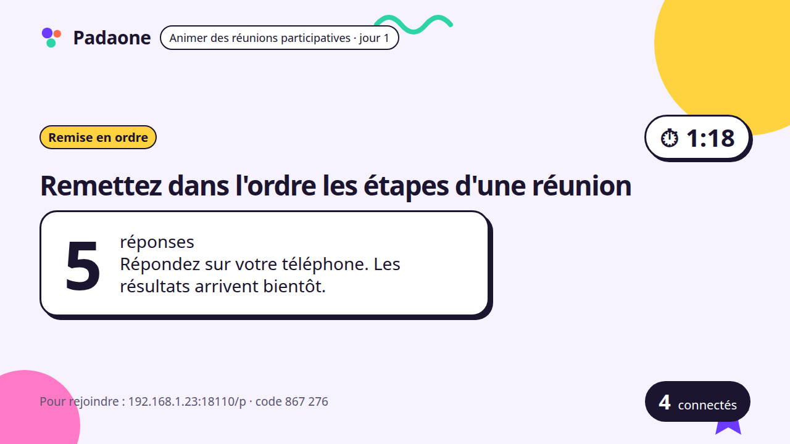

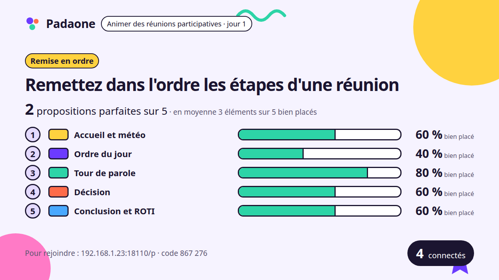

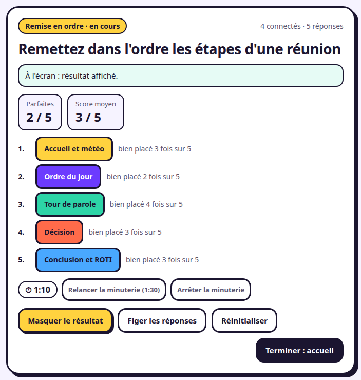

### ROTI et mot de la fin

*Pour* : clore une séquence (*Return On Time Invested* : ce temps valait-il la peine ?).
*Réglages* : la question (par défaut « Ce temps a-t-il été utile ? »).

<p>
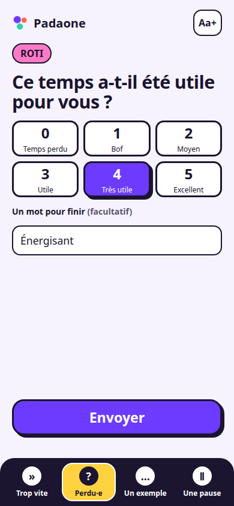
</p>

Le participant donne de 0 à 5 doigts et, s'il le veut, un mot. L'écran montre la répartition, la
moyenne et les mots de la fin (modérables comme ceux du nuage).

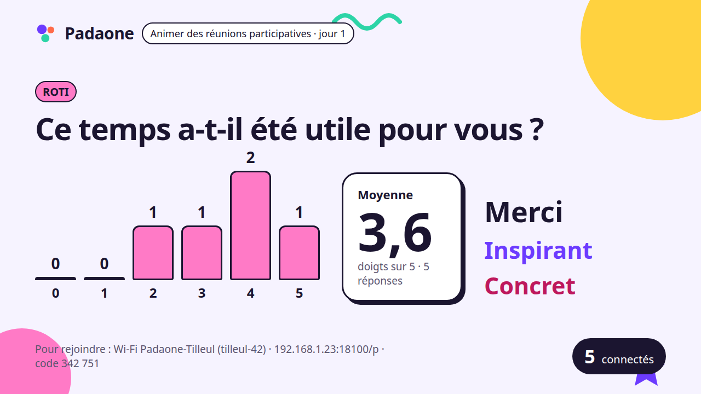

## 6. Le signal discret

En bas de chaque téléphone, une barre reste toujours accessible : **Trop vite**, **Perdu·e**,
**Un exemple**, **Une pause**. Le participant la touche quand il veut, sans lever la main ; un
second appui éteint le signal, et il s'efface de lui-même au bout de **3 minutes**.

<p>
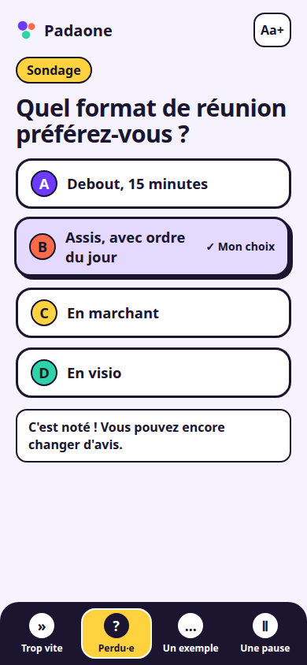
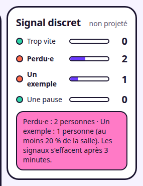
</p>

Les signaux ne sont **jamais projetés** : seule votre console les montre, sous forme de jauges. Quand un
signal concerne **au moins 20 %** des participants connectés, un encadré rose vous alerte
(« Perdu·e : 2 personnes… »). C'est le moment de proposer un exemple ou une pause.

## 7. Le Wi-Fi : réseau de la salle ou point d'accès Padaone

Les téléphones doivent être sur le **même réseau** que votre PC.

- **Le Wi-Fi de la salle marche et tout le monde peut s'y connecter** : rien à faire, l'adresse
  affichée à l'écran fonctionne.
- **Il n'y a pas de Wi-Fi, il est saturé, ou il isole les appareils** (fréquent dans les hôtels et les
  administrations) : votre PC devient lui-même le point d'accès Wi-Fi (**sous Linux** ; sous Windows
  et macOS, prévoyez un routeur de voyage).

### La page « Point d'accès »

Dans la console, cliquez sur **Wi-Fi : point d'accès**.

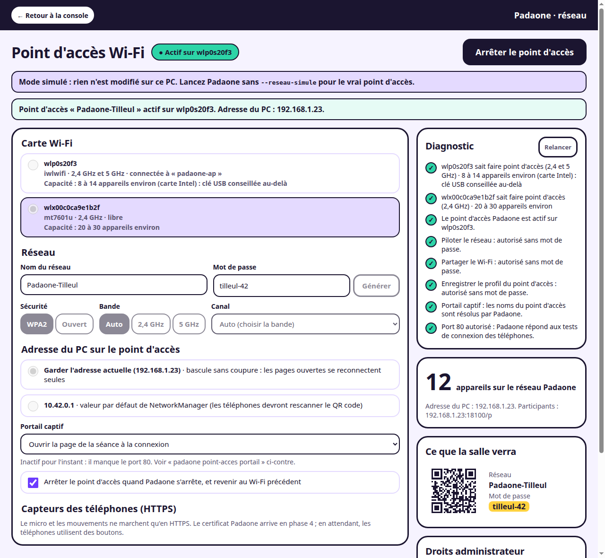

1. **Carte Wi-Fi** : Padaone propose de préférence une carte libre (une clé Wi-Fi USB), pour garder
   internet sur l'autre. Avec une seule carte, le PC perd internet pendant la séance : sans
   conséquence pour Padaone.
2. **Réseau** : un nom et un mot de passe faciles à lire au tableau sont proposés (« Padaone-Tilleul »,
   « tilleul-42 ») ; **Générer** en propose d'autres. Gardez **WPA2** (protégé) sauf raison
   particulière ; **Bande** *Auto* ou *2,4 GHz* convient à tous les téléphones.
3. **Adresse** : **Garder l'adresse actuelle** permet une bascule sans coupure : les pages déjà
   ouvertes se reconnectent seules.
4. **Démarrer le point d'accès** : en quelques secondes, l'écran d'accueil affiche la carte Wi-Fi
   avec son QR code (voir § 3). Le compteur indique combien d'appareils sont connectés.
5. **Arrêter le point d'accès** : le PC revient sur son Wi-Fi précédent. Si la case « Arrêter quand
   Padaone s'arrête » est cochée (par défaut), Ctrl+C dans le terminal le fait aussi.

Le **diagnostic** à droite vérifie la carte, les bandes, la capacité estimée et les droits. Une coche
verte partout : tout est prêt. Le diagnostic se lance aussi depuis un terminal, sans rien modifier :
`./Padaone-0.3.0-x86_64.AppImage point-acces diag`.

> **Combien de téléphones ?** Une carte Wi-Fi intégrée (Intel, la plus courante) tient souvent
> **8 à 14 appareils**. Au-delà, branchez une clé Wi-Fi USB (une vingtaine d'euros) ou un petit
> routeur de voyage. Faites un essai avant la formation.

### Le portail captif : la page s'ouvre toute seule

Sans internet, Android affiche d'habitude « Connecté, sans internet » et peut basculer sur les données
mobiles. Avec le **portail captif**, le téléphone affiche à la place **« Se connecter au réseau »** :
en touchant la notification, la page de la séance s'ouvre directement. Sur iPhone, elle s'ouvre seule.

Le réglage **Portail captif** de la page Point d'accès propose trois modes :

| Mode | Ce que font les téléphones |
| --- | --- |
| **Ouvrir la page de la séance** (conseillé) | Notification « Se connecter au réseau » qui ouvre Padaone |
| **Silencieux** | Pas de page ; Android parle de « connexion limitée » |
| **Désactivé** | « Sans internet » |

Le participant peut participer directement dans la petite fenêtre de connexion : qu'il la garde
ouverte. Sur iPhone, qu'il ne touche pas « Annuler », qui peut déconnecter du Wi-Fi.

**Installation unique, avec le mot de passe administrateur.** Le portail captif demande deux réglages
du système, à faire une seule fois par PC. Padaone ne les fait jamais lui-même : il affiche les
commandes à copier dans un terminal.

```bash
./Padaone-0.3.0-x86_64.AppImage point-acces portail
```

Tant que ce n'est pas fait, la page Point d'accès l'indique sous le réglage du portail, et Padaone
fonctionne normalement (seul le message « sans internet » reste).

### Les droits administrateur

Démarrer le point d'accès passe par NetworkManager avec les droits de votre session : sur un PC
personnel, aucun mot de passe n'est demandé. Sur un poste partagé, le système peut demander le mot de
passe administrateur. `point-acces droits` explique ce qu'il en est sur votre PC. Padaone ne stocke
jamais ce mot de passe.

## 8. Anonymat, données et reprise après un incident

- **Anonymat** : un participant n'est qu'un numéro tiré au hasard, gardé dans son navigateur. Aucun
  nom n'est demandé. La console voit les réponses, jamais leurs auteurs. Rien ne s'affiche à l'écran
  sous 3 réponses.
- **Données** : tout reste sur votre PC. Chaque séance est enregistrée dans un **journal**, qui ne
  contient ni nom ni adresse : `~/.local/share/padaone/seances/` sous Linux,
  `~/Library/Application Support/padaone/seances/` sous macOS, `%APPDATA%\padaone\seances\` sous Windows. Supprimez-le quand vous
  n'en avez plus besoin.
- **Reprise après un incident** (PC éteint par erreur, plantage) : relancez Padaone en lui donnant le
  journal de la séance. Le déroulé, les réponses et le code sont restaurés, et les téléphones se
  reconnectent seuls :

  ```bash
  ./Padaone-0.3.0-x86_64.AppImage --reprendre ~/.local/share/padaone/seances/seance-…-342751.jsonl
  ```

## 9. En cas de souci

| Symptôme | Que faire |
| --- | --- |
| Les téléphones n'ouvrent pas la page (Windows) | Autoriser Padaone dans le pare-feu sur les réseaux privés, et déclarer le Wi-Fi « privé ». |
| Les téléphones n'ouvrent pas la page | Vérifier qu'ils sont sur le même Wi-Fi que le PC. Sinon, démarrer le point d'accès (§ 7). Taper l'adresse affichée plutôt que scanner. |
| « Ce code ne correspond pas à la séance en cours » | Le participant a gardé un ancien lien : rescanner le QR code de l'écran. |
| La console ou l'écran affiche « Clé absente ou incorrecte » | Le lien est ancien (vous avez utilisé `--nouvelle-cle`) : rouvrir les liens affichés dans le terminal. |
| L'écran n'affiche pas le résultat | Avez-vous cliqué sur **Révéler** ? Y a-t-il au moins 3 réponses ? La ligne « À l'écran : … » de la console le dit. |
| Un participant ne peut plus répondre | L'activité est peut-être figée (bouton **Rouvrir les réponses**). |
| « Connexion perdue, on réessaie… » | Le téléphone ou le PC a perdu le réseau un instant : la page se reconnecte seule. |
| Android dit « sans internet » | Normal sans portail captif ; installer le portail (§ 7) ou faire toucher « Garder la connexion ». |
| Le point d'accès ne démarre pas | Lire le message de la page Point d'accès et le diagnostic ; essayer la bande 2,4 GHz. |
| Plus de 14 téléphones n'arrivent pas à se connecter | Limite de la carte intégrée : clé Wi-Fi USB ou routeur de voyage. |

## 10. Mémo des options

| Commande | Effet |
| --- | --- |
| `--titre "…"` | Titre affiché sur les téléphones et à l'écran |
| `--ouvrir-console` | Ouvre la console dans le navigateur au lancement |
| `--port 8080` | Port du serveur (8080 par défaut) |
| `--adresse 192.168.1.37` | Adresse annoncée aux téléphones, si la détection automatique se trompe |
| `--reprendre <journal>` | Reprend une séance après un incident |
| `--sans-journal` | N'enregistre rien (pour s'entraîner) |
| `--nouvelle-cle` | Change la clé secrète de la console et de l'écran |
| `--reseau-simule` | S'entraîner avec le point d'accès sans toucher au réseau du PC |
| `--sans-portail` | Sans portail captif |
| `point-acces diag` | Diagnostic des cartes Wi-Fi (ne modifie rien) |
| `point-acces droits` | Explique les droits nécessaires au point d'accès |
| `point-acces portail` | État du portail captif et commandes d'installation |
| `point-acces demarrer` / `arreter` | Point d'accès depuis le terminal, sans la console |

Toutes les options : `./Padaone-0.3.0-x86_64.AppImage --help`.
